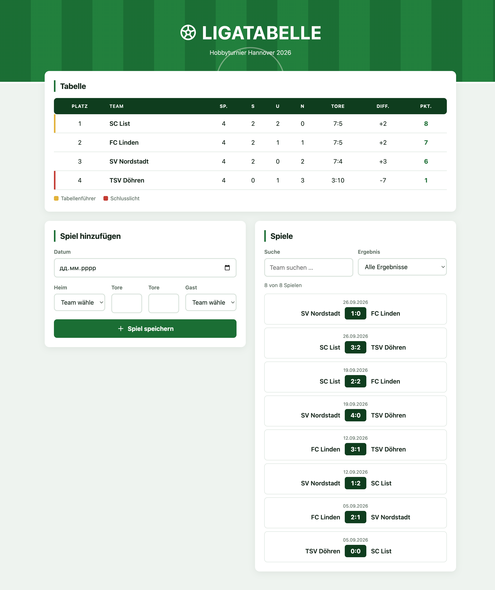

# ⚽ Ligatabelle – Hobbyturnier Hannover 2026


Eine kleine Web-App, die aus eingetragenen Spielergebnissen automatisch die Tabelle eines Hobbyturniers berechnet und sortiert.

Abschlussprojekt im Modul **Frontend-Programmierung mit JavaScript** an der Hochschule Hannover.

---

## 📋 Inhalt

- [Projektübersicht](#-projektübersicht)
- [Features](#-features)
- [Tech-Stack](#-tech-stack)
- [Starten](#-starten)
- [Bedienung](#-bedienung)
- [Fachlogik](#-fachlogik)
- [Projektstruktur](#-projektstruktur)
- [Screenshot](#-screenshot)
- [KI-Nutzung](#-ki-nutzung)
- [Autor](#-autor)

---

## 🏟️ Projektübersicht

Die App verwaltet die Spiele eines Turniers mit vier Teams. Jedes Spiel besteht aus Datum, Heimteam, Gastteam und den Toren beider Teams.

Die Tabelle wird **nicht gespeichert**, sondern bei jeder Änderung neu aus allen Spielen berechnet. Dadurch passen Tabelle und Spiele immer zusammen.

---

## ✨ Features

| Feature | Beschreibung |
|---|---|
| 📊 **Tabelle** | Platz, Spiele, Siege, Unentschieden, Niederlagen, Tore, Tordifferenz, Punkte |
| 🔢 **Automatische Sortierung** | nach Punkten, Tordifferenz, erzielten Toren und Name |
| 🥇 **Markierungen** | Tabellenführer (gold) und Schlusslicht (rot) |
| 📅 **Spielliste** | alle Partien mit Datum und Ergebnis, neueste zuerst |
| ➕ **Spiel hinzufügen** | Formular mit Validierung und Fehlermeldungen |
| 🔍 **Suche** | nach Teamnamen, unabhängig von Groß-/Kleinschreibung und Leerzeichen |
| 🎯 **Filter** | nach Ergebnis: Heimsieg, Unentschieden, Auswärtssieg |
| 🔔 **Toasts** | eigene Benachrichtigungen bei Erfolg und Fehler |
| 🎨 **Eigene SVG-Icons** | ohne Icon-Bibliothek |
| 📱 **Responsive** | funktioniert auf Desktop, Tablet und Smartphone |

---

## 🛠️ Tech-Stack

**HTML5**
- Semantische Struktur: `header`, `main`, `section`, `table`
- Formular mit `label`, `input type="date"` / `"number"`, `select`, eigene Validierung (`novalidate`)
- Eigene SVG-Icons mit `<symbol>` und `<use>`
- Barrierefreiheit: `aria-live`, `aria-label`, `lang="de"`

**CSS3**
- Layout mit CSS Grid und Flexbox, responsive mit Media Queries
- CSS-Variablen für Farben und Abstände
- BEM-Namenskonvention (`block__element--modifier`)
- Animationen mit `@keyframes`, Rücksicht auf `prefers-reduced-motion`

**JavaScript (ES6+)**
- DOM-Manipulation: `querySelector`, `createElement`, `createElementNS`, `append`, `textContent`, `classList`
- Events: `addEventListener` für `submit`, `input`, `change`, `click`, `animationend`; `preventDefault`
- Formularauswertung mit `FormData`
- Array-Methoden: `forEach`, `filter`, `sort`, `some`, `push`, `Object.values`
- String-Methoden: `trim`, `toLowerCase`, `includes`, `split`, `localeCompare`
- Moderne Syntax: Arrow Functions, Template Literals, Destrukturierung, Spread-Operator
- Timer: `setTimeout`, `clearTimeout`
- Laden der Skripte mit `defer`, Strict Mode

Keine Bibliotheken, kein Framework, keine externen Ressourcen.

---

## 🚀 Starten

1. Projektordner entpacken
2. `index.html` per Doppelklick im Browser öffnen

Ein Server oder eine Installation ist nicht nötig.

---

## 🖱️ Bedienung

**Spiel eintragen**

1. Datum wählen
2. Heim- und Gastteam aus der Liste wählen
3. Tore beider Teams eingeben
4. Auf **Spiel speichern** klicken

Die Tabelle wird sofort neu berechnet, eine Benachrichtigung bestätigt das Speichern.

**Spiele durchsuchen**

- Im Feld **Suche** einen Teamnamen eingeben, z. B. `linden`
- Im Feld **Ergebnis** nach Heimsieg, Unentschieden oder Auswärtssieg filtern
- Suche und Filter lassen sich kombinieren; die Tabelle bleibt dabei unverändert

---

## 🧮 Fachlogik

**Punktevergabe**

| Ergebnis | Punkte |
|---|---|
| Sieg | 3 |
| Unentschieden | 1 |
| Niederlage | 0 |

**Berechnung der Tabelle**

1. Für jedes Team wird eine leere Tabellenzeile angelegt.
2. Jedes Spiel wird zweimal eingetragen: aus Sicht des Heimteams und aus Sicht des Gastteams.
3. Die Zeilen werden sortiert.

**Sortierung bei Punktgleichheit**

1. Punkte
2. Tordifferenz
3. Erzielte Tore
4. Teamname (alphabetisch)

**Validierung des Formulars**

- Datum ist Pflicht
- Beide Teams müssen gewählt sein
- Ein Team kann nicht gegen sich selbst spielen
- Tore müssen ganze Zahlen ab 0 sein
- Eine Partie (gleiches Heim- und Gastteam) darf nur einmal eingetragen werden

---

## 📁 Projektstruktur

```
ligatabelle/
├── index.html        # Seitenstruktur und SVG-Icons
├── README.md
├── css/
│   └── style.css     # Gestaltung
├── docs/
│   └── screenshot.png
└── js/
    ├── data.js       # Teams und Startdaten (8 Spiele)
    ├── league.js     # Fachlogik: Tabelle, Validierung, Filter
    ├── ui.js         # Ausgabe im DOM
    ├── toast.js      # Benachrichtigungen
    └── app.js        # Zustand, Events, Start der App
```

**Trennung der Aufgaben:** `league.js` rechnet und greift nicht auf das DOM zu, `ui.js` zeigt nur an, `app.js` verbindet beides.

---

## 📸 Screenshot



---

## 🤖 KI-Nutzung

**Werkzeug:** Claude (Anthropic)

**Wofür:**

- Planung der Aufgabe: wie man das Projekt sinnvoll aufbaut und worauf man bei der Umsetzung achten sollte
- Umsetzung eigener Toast-Benachrichtigungen ohne externe Bibliotheken und typische Stolperstellen dabei
- Vertiefte Erklärung der Array-Methoden und welche Methode sich für welche Aufgabe eignet
- Arbeit mit Formularen über `FormData`
- Code-Beispiele zu diesen Themen, die ich nachvollzogen, selbst umgesetzt und an mein Projekt angepasst habe
- Hilfe bei der Fehlersuche

**Weitere Hilfsmittel:**

- Kursunterlagen von Patrick Baudach (Hochschule Hannover)
- [learn.javascript.ru](https://learn.javascript.ru)
- [w3schools.com](https://www.w3schools.com)

---

## 👤 Autor

**Oleh Fostii**
Hochschule Hannover

Modul: Frontend-Programmierung mit JavaScript

Dozent: Patrick Baudach

Studienprojekt, Oktober 2026